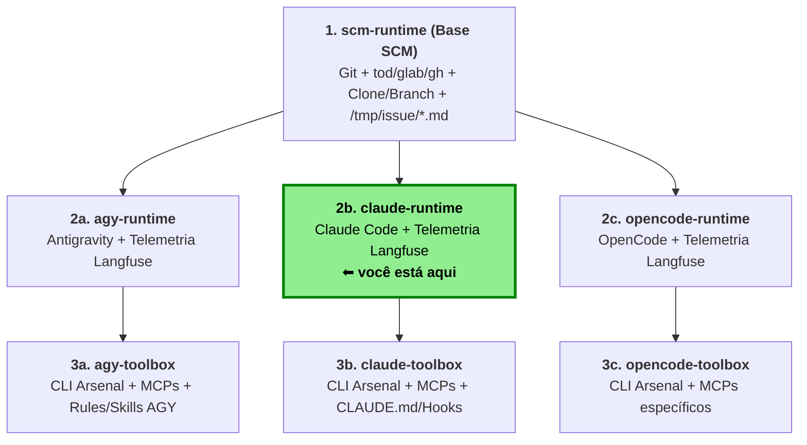

## Visão geral

`claude-runtime` é um runtime Docker para **Claude Code** que estende a imagem base `scm-runtime`.

Ele incorpora o CLI do Claude Code, o plugin `langfuse-observability` para telemetria e um conjunto de regras de governança que geram automaticamente contexto para o agente a partir do repositório e, opcionalmente, de uma issue do projeto.

A imagem é **camada‑2**: herda toda a funcionalidade de `scm-runtime` (clonagem, obtenção de issues, geração de markdowns, execução autônoma) e acrescenta as seguintes funcionalidades:

* **Claude Code** – instalado via `mise` no container.
* **Telemetria Langfuse** – plugin instalado em tempo de build.
* **Regras personalizadas** – `claude-start.sh` monta `~/.claude/rules/runtime-context.md` baseado no repo, issue e comentarios e exporta variáveis de ambiente para rastreio.

---

## Imagem Base (`scm-runtime`)

A imagem base concentra-se em *controlar fonte e issues*:

```
docker build . -t scm-runtime:latest
```

Ela executa as seguintes ações:

1. **Clona** um repositório Git determinado pelas variáveis de ambiente.
2. **Obtém** dados de issue (GitHub, GitLab, OneDev) se `ISSUE_ID` estiver definido, gerando arquivos Markdown em `/tmp/issue/`.
3. Disponibiliza um **modo “autônomo”** que executa um comando passado, captura sua saída e a publica como comentário na issue.
4. Gera um conjunto de markdowns (`repo.md`, `cli.md`, `issue.md`, `comments.md`) em `/tmp/repo/` e `/tmp/issue/` que são posteriormente injetados no contexto do runtime do Claude.

### Variáveis de Ambiente-chave (base)

| Variável            | Obrigatória  | Descrição                                                    | Exemplo                              |
|---------------------|--------------|--------------------------------------------------------------|--------------------------------------|
| `GIT_SERVER_TYPE`   | ✓            | Tipo de forge (`onedev`, `gitlab`, `github`)                 | `onedev`                             |
| `GIT_REPO_URL`      | ✓            | URL HTTPS do repositório                                     | `https://github.com/org/repo.git`    |
| `GIT_TOKEN`         | ✓            | Token de acesso ao forge                                     | `xyz--zzz`                           |
| `GIT_USERNAME`      | Opcional     | Usuário para credenciais (padrão `git`)                      | `git`                                |
| `GIT_BASE_BRANCH`   | ✓            | Branch base clonada primeiro                                 | `main`                               |
| `GIT_BRANCH`        | ✓            | Branch de trabalho (`issue/<ID>` quando `ISSUE_ID` definido) | `agent/minha-tarefa`                 |
| `GIT_USER_NAME`     | ✓            | Nome de usuário Git                                          | `MyAgent`                            |
| `GIT_USER_EMAIL`    | ✓            | Email de usuário Git                                         | `myagent@example.com`                |
| `GIT_CO_AUTHOR`     | Opcional     | Co‑autor para commits (`Nome <email>`)                       | `Some human <somehuman@example.com>` |
| `ISSUE_ID`          | Opcional     | ID da issue a baixar                                         | `123`                                |
| `AUTONOMOUS_MODE`   | Opcional     | `true` para executar comando e comentar na issue             | `true`                               |
| `MAX_COMMENT_CHARS` | Opcional     | Máximo de caracteres da resposta na issue (padrão `60000`)   | `50000`                              |

> **Exemplo de `.env`** (será usado com `--env-file` ao executar o container)

```dotenv
# Tipo de forge
GIT_SERVER_TYPE=onedev

# URL do repositório a ser clonado
GIT_REPO_URL=http://onedev.uaiso.lan/demo-test.git

# Token de acesso
GIT_TOKEN=<SEU_TOKEN>

# Usuário para credenciais (padrão: git)
GIT_USERNAME=git

# Branch base
GIT_BASE_BRANCH=main

# Branch de trabalho (sobrescrita por `issue/<ID>` se `ISSUE_ID` vázio)
GIT_BRANCH=agent/minha-tarefa

# Identidade Git
GIT_USER_NAME=MyAgent
GIT_USER_EMAIL=myagent@example.com

# Opção de co‑autor
GIT_CO_AUTHOR=Some human <somehuman@example.com>

# ID opcional de issue
# ISSUE_ID=123

# Execução autônoma
# AUTONOMOUS_MODE=true
```

### Construindo a Imagem Base

```bash
docker build . -t scm-runtime:latest
```

### Executando a Imagem Base

```bash
docker run --rm -it \
  --env-file ./.env/meurepo \
  scm-runtime:latest
```

**Modo autônomo (substituição de comando)**

```bash
docker run --rm -it \
  --env-file ./.env/meurepo \
  --env ISSUE_ID=1 \
  --env AUTONOMOUS_MODE=true \
  scm-runtime:latest \
  seu-comando-aqui
```

### Artefatos gerados

| Caminho                  | Conteúdo                                                   | Quando criado          |
|--------------------------|------------------------------------------------------------|------------------------|
| `/tmp/repo/repo.md`      | Informações do repositório (forge, URL, branches)          | sempre                 |
| `/tmp/repo/cli.md`       | Exemplos de comandos da CLI do forge (`tod`, `glab`, `gh`) | sempre                 |
| `/tmp/issue/issue.md`    | Título, descrição e estado da issue                        | se `ISSUE_ID` definido |
| `/tmp/issue/comments.md` | Comentários da issue em ordem cronológica                  | se `ISSUE_ID` definido |
| `/tmp/issue/*.json`      | JSON bruto da issue e comentários (não versionado)         | se `ISSUE_ID` definido |

---

## Runtime (`claude-start.sh`)

O script em `rootfs/usr/local/bin/claude-start.sh`:

* Monta `~/.claude/rules/runtime-context.md` a partir dos markdowns gerados.
* Exporta tags de rastreio para a Langfuse (`mode:<modo>`).
* Inicializa o CLI do Claude Code interativamente por padrão, ou em modo autônomo (`claude -p \"$ISSUE_PROMPT\" --dangerously-skip-permissions`).
* Usa `MODEL` opcional para definir o modelo do Claude (`claude --model \"$MODEL\"`).

### Variáveis de Ambiente-chave (claude-runtime)

| Variável         | Obrigatória | Descrição                                                | Exemplo           |
|------------------|-------------|----------------------------------------------------------|-------------------|
| `ISSUE_PROMPT`   | Opcional    | Prompt inicial enviado ao Claude Code                    | `Resolva a issue` |
| `ISSUE_COMMENTS` | Opcional    | `true` para incluir `/tmp/issue/comments.md` no contexto | `true`            |
| `MODEL`          | Opcional    | Modelo do Claude Code (`--model`)                        | `gpt-oss:20b`     |

### Construindo a Imagem `claude-runtime`

```bash
docker build --build-arg GIT_SHA=$(git rev-parse --short HEAD) -t claude-runtime:latest .
```

### Executando o `claude-runtime`

```bash
docker run --rm -it \
  --env-file ./.env/meurepo \
  claude-runtime:latest
```

* **Interativo** – executa o container sem `AUTONOMOUS_MODE`; roda o CLI e aguarda.
* **Autônomo** – defina `AUTONOMOUS_MODE=true` e opcionalmente `ISSUE_ID` para executar um comando e publicar a saída.

---

## Telemetria Langfuse

- **Plugin**: `langfuse-observability` instalado no build.
- **Variáveis de ambiente necessárias (tempo de execução)**

```dotenv
LANGFUSE_PUBLIC_KEY=pk-lf-...
LANGFUSE_SECRET_KEY=sk-lf-...
LANGFUSE_BASE_URL=http://langfuse.example.com
```

quando LANGFUSE_USER_ID não informado, faz fallback para email de GIT_CO_AUTHOR, e fallback para GIT_USER_EMAIL

```dotenv
LANGFUSE_USER_ID=some-user
```
